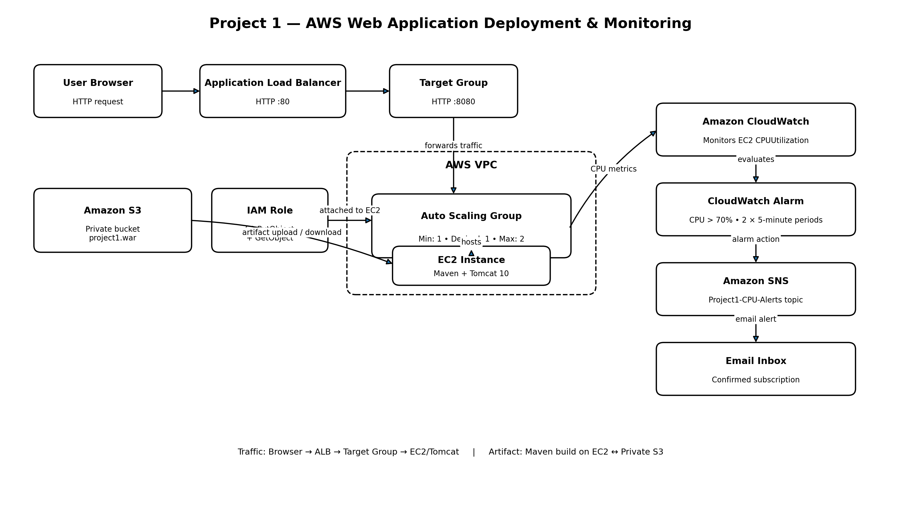

# AWS Web Application Deployment & Monitoring

A hands-on AWS cloud infrastructure project demonstrating web application deployment, load balancing, artifact storage, access management, and monitoring with email notifications.

## Architecture Diagram

## Project Overview

This project demonstrates how to deploy a Java web application on AWS using Amazon EC2 and Apache Tomcat, distribute incoming HTTP traffic through an Application Load Balancer, store application artifacts in a private Amazon S3 bucket, and monitor infrastructure using Amazon CloudWatch and Amazon SNS.

## AWS Services Used

| Service | Purpose |
|---|---|
| Amazon EC2 | Hosts the web application |
| Launch Template | Defines EC2 launch configuration |
| Auto Scaling Group | Maintains the configured instance capacity |
| Application Load Balancer | Distributes incoming HTTP traffic |
| Target Group | Routes traffic to EC2 instances |
| Amazon S3 | Stores application WAR artifacts privately |
| AWS IAM | Provides EC2 access to S3 |
| Amazon CloudWatch | Monitors EC2 CPU utilization |
| Amazon SNS | Sends email notifications from CloudWatch alarms |

## Technology Stack

- Ubuntu Linux
- Apache Tomcat 10
- Java
- Apache Maven
- AWS CLI
- Amazon Web Services

## Application Deployment Workflow

1. Created a Java web application packaged as a WAR file.
2. Built the application using Apache Maven.
3. Uploaded the WAR artifact to a private Amazon S3 bucket.
4. Configured an IAM role to allow the EC2 instance to access S3.
5. Downloaded the WAR artifact from S3 to EC2.
6. Deployed the application to Apache Tomcat 10.
7. Verified application availability through the Application Load Balancer.

## Infrastructure Configuration

- AWS Region: Asia Pacific (Sydney) — `ap-southeast-2`
- Operating System: Ubuntu Linux
- Web Server: Apache Tomcat 10
- Load Balancer: Application Load Balancer
- EC2 Instance Type: `t3.micro`
- Auto Scaling Group: Minimum 1, Desired 1, Maximum 2
- Application Protocol: HTTP

## Monitoring and Notifications

Configured Amazon CloudWatch to monitor EC2 CPU utilization.

Alarm configuration:

- Metric: `CPUUtilization`
- Statistic: Average
- Evaluation period: 5 minutes
- Threshold: Greater than 70%
- Datapoints: 2 out of 2
- Notification service: Amazon SNS
- Notification method: Email

The SNS email subscription was confirmed, and the CloudWatch alarm reached the `OK` state.

## Application Verification

The deployed application was verified through:

- Local Tomcat endpoint: `http://localhost:8080/project1/`
- Application Load Balancer endpoint: `/project1/`
- HTTP response: `200 OK`

The application displays the deployment status, application version, hosting platform, web server, load balancer, and artifact storage information.

## Key Learning Outcomes

- Deploying web applications on AWS EC2.
- Configuring Application Load Balancers and Target Groups.
- Working with Launch Templates and Auto Scaling Groups.
- Building WAR artifacts using Maven.
- Managing application artifacts using Amazon S3.
- Configuring IAM roles and permissions.
- Monitoring infrastructure using CloudWatch.
- Configuring SNS email notifications.

## Project Status

**Deployment and monitoring successfully completed.**

This project was implemented as a hands-on cloud learning exercise.

## Author

**Abdul Basir**

Aspiring AWS Cloud Engineer | DevOps Enthusiast
